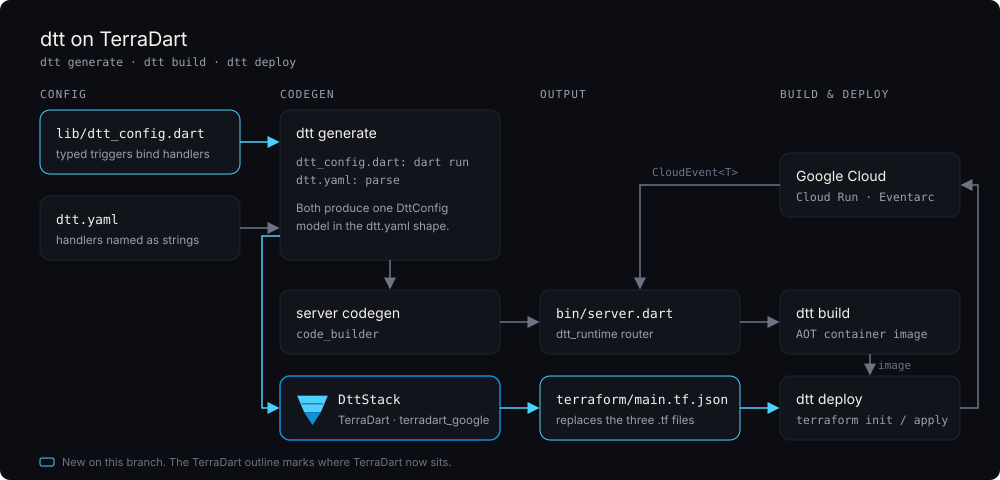

# dtt on TerraDart



## What changed

- `dtt generate` builds the Terraform with [TerraDart](https://terradart.dev)
  (`terradart_google` 0.36) and writes a single `terraform/main.tf.json`. The
  hand-written HCL writer is gone.
- Services can be configured in Dart with `lib/dtt_config.dart`. Handlers are
  bound by type, so a mismatched payload is a compile error. `dtt.yaml` still
  works.
- `dtt deploy` is unchanged. It runs `terraform init` and `apply` in
  `terraform/`.

## Before and after

`dtt.yaml`:

```yaml
service:
  name: gcs-triggers
  project_id: dtt-pkg-test
  region: us-central1

triggers:
  - name: on-upload
    type: google.cloud.storage.object.v1.finalized
    path: /events/uploads
    handler: onUpload
    bucket: dtt-pkg-test-upload
```

`lib/dtt_config.dart`:

```dart
final dttConfig = DttConfig(
  service: const Service(
    name: 'gcs-triggers',
    projectId: 'dtt-pkg-test',
    region: 'us-central1',
  ),
  triggers: [
    Trigger.gcsObjectFinalized(
      name: 'on-upload',
      bucket: 'dtt-pkg-test-upload',
      handler: onUpload,
    ),
  ],
);
```

## Fixed configs

- `kind: job` now validates. It emits a real Cloud Run job, and each trigger
  runs it through a Workflows workflow.
- `retry_policy` is emitted as a block, `{max_attempts: N}`, instead of an
  invalid string argument.
- `security_profile: secure` initializes. It no longer depends on a module that
  does not support the Google provider 8.x.

## Design choices

- Jobs go through Workflows because Eventarc cannot start a Cloud Run job
  directly.
- The secure profile uses one internal Cloud Run service with a dedicated,
  role-less runtime service account instead of the
  `GoogleCloudPlatform/cloud-run/google` module.
- A string `retry_policy` is rejected at generate time so it cannot reach
  `terraform apply`.
- Labels are set on each resource because TerraDart's `GoogleProvider` has no
  `default_labels`.
- The Dart config is evaluated with `dart run` and turned into the same model as
  `dtt.yaml`, so both paths share one generator.
